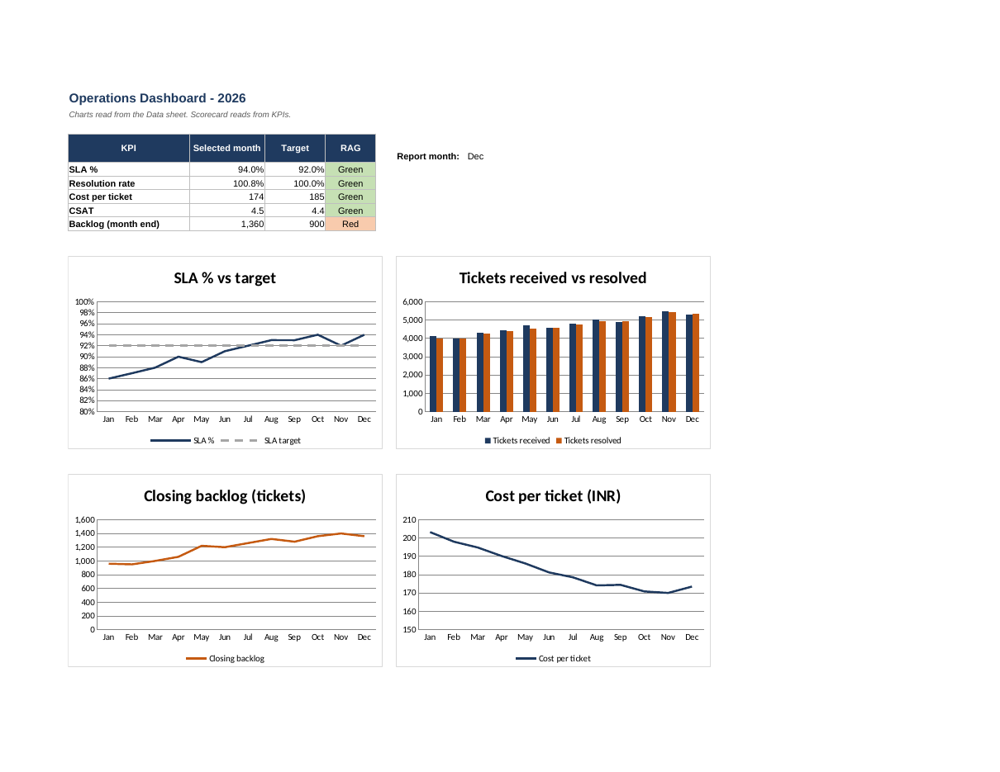

# Operations KPI Dashboard

A monthly operations scorecard for a customer-operations team: volume, SLA, backlog, cost per ticket and CSAT, each compared with a target and given a RAG status.

## The problem it solves
Operations reviews often drown in numbers. This workbook answers one question per KPI: are we on target, and which way is it moving?

## What it does
- **Data sheet:** 12 months of inputs (received, resolved, within SLA, cost, CSAT). Backlog, SLA %, resolution rate and cost per ticket are calculated.
- **Targets sheet:** one place to set targets, tolerance bands and direction (higher or lower is better).
- **KPI scorecard:** pick a month; see value, previous month, change, target, year-to-date (volume-weighted) and RAG.
- **Dashboard:** SLA vs target, received vs resolved, closing backlog and cost per ticket trends.

## What the sample data shows
SLA, cost per ticket and CSAT are on target by December, but the **backlog is Red at 1,360 against a target of 900**. Demand grew faster than resolution capacity through the year, so the case for added capacity or deflection is the story in the numbers.

## How to use
Change the yellow report month on the KPIs sheet, edit blue inputs on Data and Targets, and the dashboard follows.

## Skills shown
KPI design, target setting, variance and RAG logic, operational analytics, Excel (INDEX/MATCH, weighted averages, conditional formatting, charts).

## Notes
- All numbers are **fictional sample data**.
- Built by Anubhav Saxena with Claude as a build assistant.
